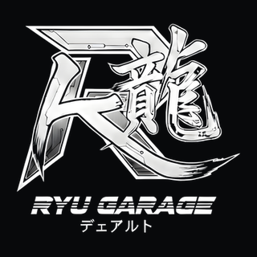
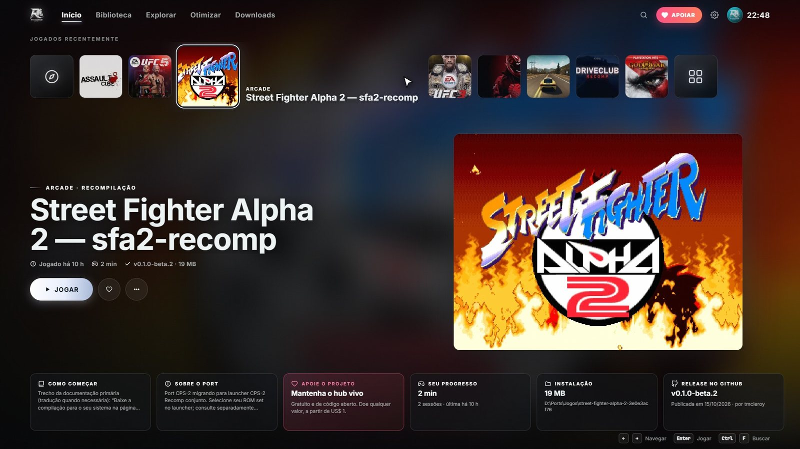
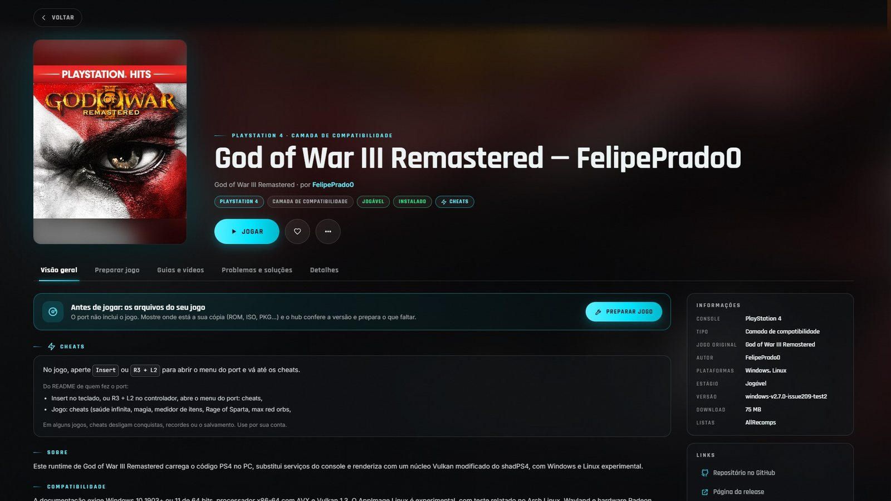
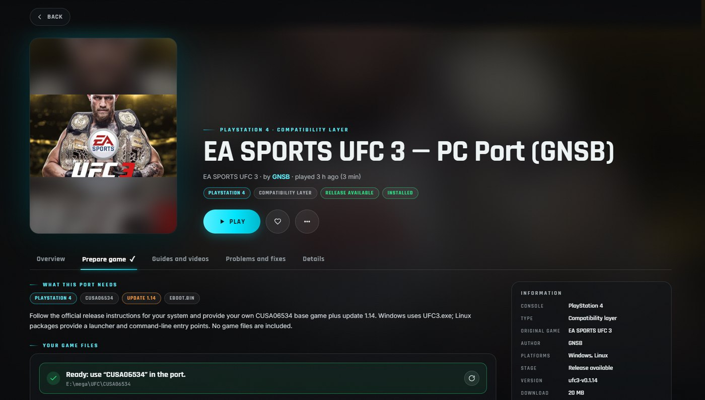
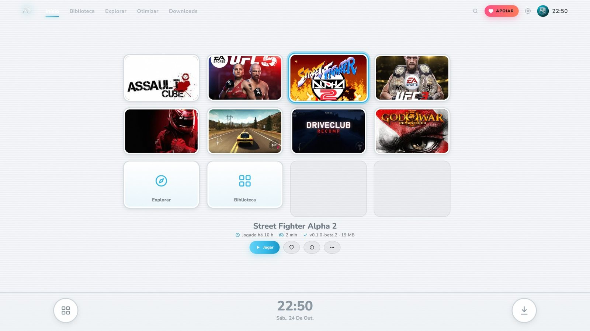
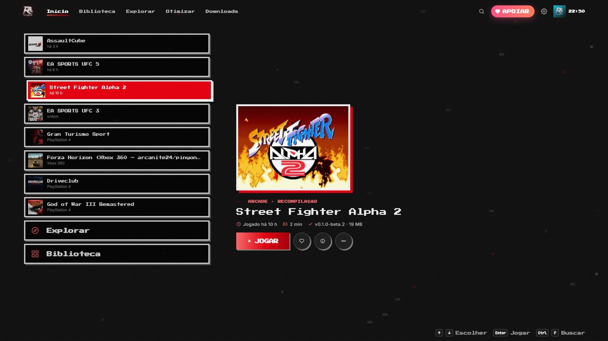
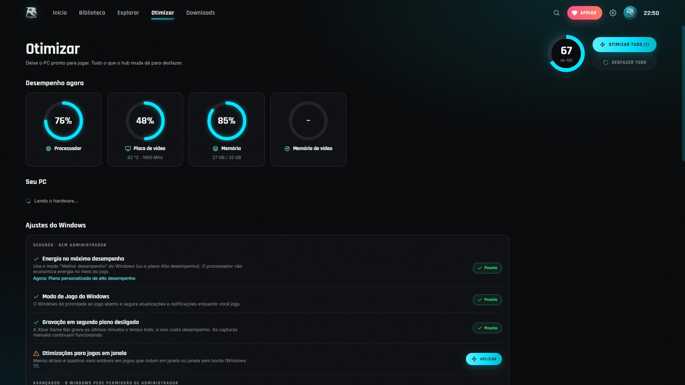
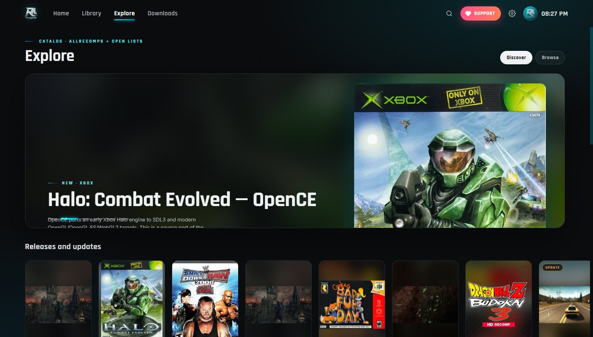
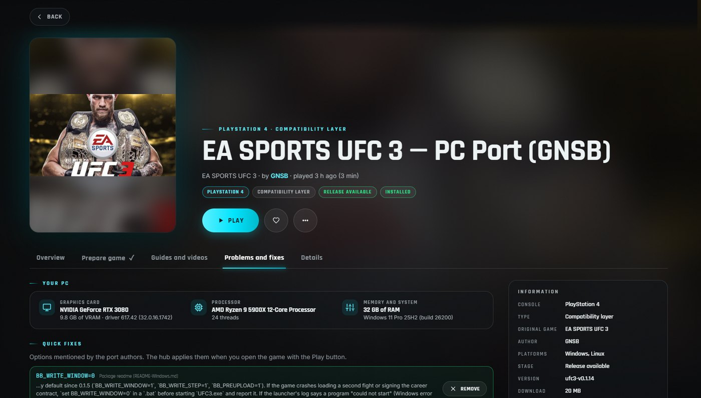
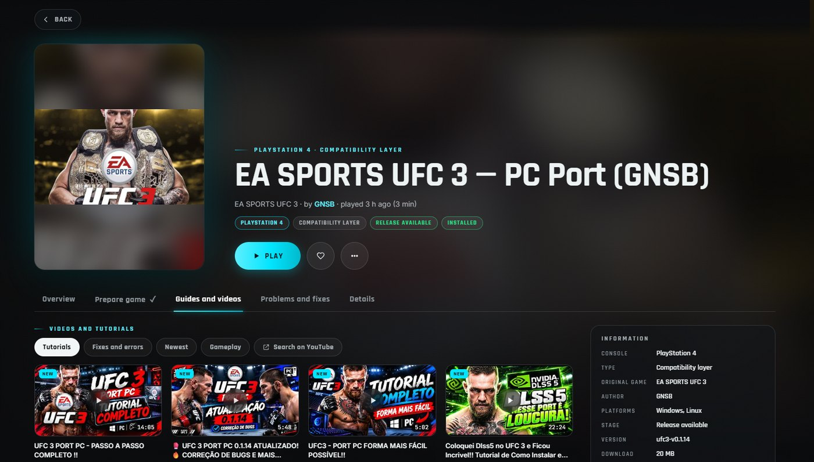

# RGARAGE — HUB

**Todos os ports e recompilações de jogos num hub só, com cara de console**
_Every game port and recompilation in one hub, with a console look_

---

## ⬇️ Download

Baixe na página de **[Releases](../../releases/latest)**:

- **`RGARAGE-HUB-x.y.z-Setup.exe`** (recomendado): instala sem pedir administrador e cria atalho na área de trabalho e no menu Iniciar. Se faltar o WebView2 da Microsoft, o instalador baixa sozinho.
- **`RGARAGE-HUB-x.y.z-portatil.zip`**: é só extrair e abrir o `RGARAGE-HUB.exe`.

> Windows 10/11 64 bits · não precisa instalar .NET · na primeira vez o Windows pode mostrar "O Windows protegeu o computador": clique em **Mais informações → Executar assim mesmo**. Depois disso o hub se atualiza sozinho, sem esse aviso.

## ✨ O que ele faz

Os ports de PC e as recompilações de jogos de console estão espalhados em milhares de repositórios do GitHub, cada um com um jeito de instalar. O RGARAGE HUB junta tudo numa vitrine estilo console, feita para você só dar o play.

- 🎮 **Mais de 2.900 projetos de 58 consoles, mais de 1.300 jogáveis no PC**: God of War III, Bloodborne, Zelda, Mario 64, GTA San Andreas, Halo, UFC e muito mais, reunidos do [AllRecomps](https://allrecomps.com), do [Awesome Decomp Games](https://github.com/SubmitGame/awesome-decomp-games) e do [Recompiled Games List](https://github.com/wangxiaoxiang5599/recompiled-games-list).
- ⬇️ **Instalação com um clique**, direto da release oficial de cada projeto, com fila de downloads e retomada.
- 🔄 **Sempre na versão mais nova**: um índice central confere as releases de todos os ports a cada 2 horas, e o hub avisa quando um jogo instalado ganha atualização. O próprio hub também se atualiza sozinho e confere o SHA-256 de cada versão.
- 🛠️ **Builds RGARAGE**: ports de código aberto que não têm build para Windows ganham um compilado por nós, com licença, créditos e código-fonte no pacote ([RGARAGE-Builds](https://github.com/DuarttBR/RGARAGE-Builds)).
- 📀 **Preparar jogo**: você mostra onde está a **sua** cópia (ROM, ISO, BIN/CUE, PKG, pasta) e o hub identifica, confere ID, versão, região e SHA-1, extrai PKG de PS4 e aplica o update, converte ROM de N64 para `.z64` e grava o caminho no port.
- 🕹️ **19 estilos de console**: PS5, PS4, PS3 (XMB), Xbox 360, Wii, Switch, PS2 e outros, com cores, sons e tela inicial de cada um, por perfil.
- 🎮 **Tudo no controle**: os botões na tela viram os do seu controle (**A B X Y** do Xbox, **✕ ○ △ □** do PlayStation ou o layout da Nintendo). Modo TV incluído.
- ⚡ **Otimizar**: mostra o seu PC e o uso agora, aplica ajustes do Windows para jogos com um clique e desfaz tudo quando quiser. Avisa sobre os programas pesados abertos.
- 🧰 **Problemas e soluções**: lê o log quando o jogo fecha com erro, traz as correções recomendadas pela comunidade e separa os relatos do GitHub que batem com a sua placa e o seu processador.
- 🎯 **Cheats** de 95 ports, **atalho do jogo na área de trabalho**, **modo Parsec** para jogar com amigos à distância, **guias e vídeos** no seu idioma, **perfis** com biblioteca, favoritos e tempo de jogo, **modo leve** para PC mais fraco e interface em **7 idiomas**.

 
 
 
 

### Modo avançado

Para quem acompanha a cena de ports e emulação: listas JSON próprias e repositórios do GitHub adicionados à mão, exportar o catálogo como espelho, opções de inicialização por jogo (variáveis de ambiente e argumentos), token do GitHub e ferramentas baixadas sob demanda (ps4-pkg-extractor, extract-xiso).

## ⚖️ Importante

O RGARAGE HUB **não baixa jogos e não indica onde baixar**. Os ports funcionam com os arquivos da **sua cópia original**; a aba Preparar jogo traz o passo a passo para copiar o jogo da sua mídia ou do seu console. Cada port tem a licença e os autores dele: o hub aponta para as releases oficiais e dá o crédito a quem fez. Os jogos e as marcas pertencem aos seus donos.

## ❤️ Mantenha o projeto vivo

O RGARAGE HUB é **gratuito**. Se ele te ajudou a jogar, **apoie com qualquer valor, a partir de US$ 1**: é isso que mantém o catálogo atualizado, as correções e as funções novas.

| Como apoiar | Onde |
|---|---|
| ☕ **[Ko-fi](https://ko-fi.com/duarttbr)** | Cartão ou PayPal · valor livre · sem precisar de conta |
| ❤️ **Botão Apoiar** | No próprio app: no alto da tela, em todas as páginas, e no cartão "Apoie o projeto" do Início |
| 🇧🇷 **PIX** | Sem taxa · qualquer valor · QR e chave abaixo |
| ⭐ **Sem gastar nada** | Dê uma estrela neste repositório e indique para os amigos |

**PIX (chave aleatória):** `0a7c7e8b-ca82-4d80-801e-d5ac36cb7705` 
Bruno P. Fernandes · Banco Inter · informe o valor quando for pagar

## ✉️ Contato e parcerias

Quer participar do projeto, fazer uma parceria ou licenciar o RGARAGE HUB? Escreva para **[brunoduartza@gmail.com](mailto:brunoduartza@gmail.com)**.

Achou um problema no hub? Abra uma [issue](../../issues). Problema dentro de um jogo: no repositório do autor do port (o link fica na página do jogo, no hub).

---

## 🇺🇸 English

**Download** the latest **Setup.exe** (recommended) or the portable **.zip** from **[Releases](../../releases/latest)**. Windows 10/11 64-bit, no .NET install needed. If SmartScreen appears the first time, click **More info → Run anyway**; after that the hub updates itself without the warning.

**What it does**: a console-style showcase for every game port and recompilation, made so you just hit play.

- **2,900+ projects from 58 consoles, 1,300+ playable on PC** (God of War III, Bloodborne, Zelda, Mario 64, GTA San Andreas, Halo, UFC and more), gathered from AllRecomps, Awesome Decomp Games and Recompiled Games List.
- **One-click installs** from each project's official release, with a download queue and resume.
- **Always up to date**: a central index checks every port's releases every 2 hours and the hub tells you when an installed game has an update. The hub updates itself too and verifies each version's SHA-256.
- **RGARAGE builds**: open-source ports with no Windows build get one compiled by us, with license, credits and source code in the package ([RGARAGE-Builds](https://github.com/DuarttBR/RGARAGE-Builds)).
- **Prepare game**: point to **your own** copy (ROM, ISO, BIN/CUE, PKG, folder). The hub identifies it, checks ID, version, region and SHA-1, extracts PS4 PKGs and applies the update, converts N64 ROMs to `.z64` and saves the path in the port.
- **19 console styles** (PS5, PS4, PS3 XMB, Xbox 360, Wii, Switch, PS2 and more) with their colors, sounds and home screen, per profile.
- **Full controller support**: on-screen buttons match your controller (Xbox, PlayStation or Nintendo). TV mode included.
- **Optimize**: shows your PC and live usage, applies Windows gaming tweaks in one click and undoes everything whenever you want.
- **Problems and fixes**: reads the log when a game crashes, offers community-recommended fixes and filters GitHub reports that match your GPU and CPU.
- **Cheats** for 95 ports, **desktop shortcuts**, **Parsec mode** to play with friends remotely, **guides and videos** in your language, **profiles** with library, favorites and play time, **light mode** for weaker PCs and a UI in **7 languages**.

**Important**: RGARAGE HUB does **not** download games or point to where to get them. Ports run with the files of **your original copy**. Games and trademarks belong to their owners.

**❤️ Support the project**: the hub is free. Donate **any amount, starting at US$ 1**, on **[Ko-fi](https://ko-fi.com/duarttbr)** (card or PayPal, no account needed), through the **Support** button at the top of every screen in the app, or give this repo a ⭐.

**✉️ Contact and partnerships**: want to join the project, partner up or license RGARAGE HUB? Write to **[brunoduartza@gmail.com](mailto:brunoduartza@gmail.com)**.

---

© Ryu Garage · Este repositório contém apenas os downloads · This repository only hosts the downloads. 
Catálogo: <a href="https://allrecomps.com">AllRecomps</a>, <a href="https://github.com/SubmitGame/awesome-decomp-games">Awesome Decomp Games</a> (CC0) e <a href="https://github.com/wangxiaoxiang5599/recompiled-games-list">Recompiled Games List</a> (CC BY 4.0).
Ferramentas: <a href="https://github.com/paulomanrique/ps4-pkg-extractor">ps4-pkg-extractor</a>, <a href="https://github.com/XboxDev/extract-xiso">extract-xiso</a>, Microsoft Edge WebView2, SharpCompress.

